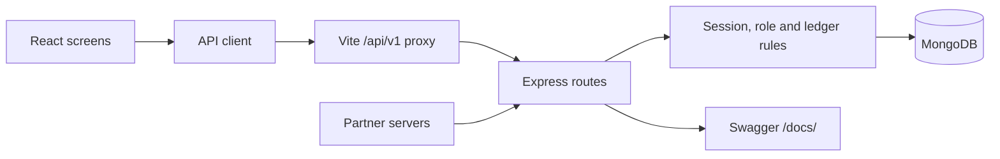

# IDSC Finance System

**System and Developer Handbook**

System Integration and Architecture school project

Updated November 23, 2026

## 1. What the system does

IDSC Finance keeps one financial account per student and academic term. The owner creates or receives an enrollment and adds charges. A signed-in cashier collects money and records it against a charge. Finance saves the payment, assigns a receipt reference, updates the balance, and includes the transaction in the daily collections report. The owner reviews exceptions and controls cashier access.

For example, an owner adds a ₱10,000 tuition charge. A cashier records ₱4,000. Finance generates a receipt for ₱4,000, leaves ₱6,000 outstanding, and reports ₱4,000 collected. The same receipt and balance can be opened after refreshing the page.

The app runs locally at [localhost:5174](http://localhost:5174/). Express serves the [Swagger API reference](http://localhost:5000/docs/).

## 2. What we built

| Stage | Work completed |
|---|---|
| Repository review | Cloned the repository, reviewed all four published branches, and used `main` as the working base. Mapped the runtime API, database models and React screens. |
| Local startup | Installed dependencies, opened the project in VS Code, configured Vite to reach the backend, and ran MongoDB in a local Docker container. |
| Clean demo and cashier access | Confirmed the original finance collections were empty. Removed the sample records and browser-only login from the active experience. The first cashier signup design used two invitations. |
| Owner and cashier approval | Replaced invitations with first-run owner setup and a two-cashier approval queue. Added session sign-in, role controls, recovery codes, and dark mode. |
| Finance workflow | Replaced transaction previews with stored enrollments, charges and payments. Added printable receipts, owner-reviewed reversals, and reconciliation by collector and payment method. |
| Partner contracts | Added separately authorized API operations for Registrar, Cashier, Library, Inventory, and Faculty. Tested each contract with fictional records in a disposable database. |
| API and documentation | Documented the routes in Swagger, added a backend-generated CSV download sharing the report calculations and access rules, and wrote this handbook. |
| Faculty payroll | Added owner-only hourly payroll runs, reviewed Faculty inputs, Personnel rates, finalization, printable payslips, and partner endpoints for Disbursement and Accounting. |
| Sidebar navigation | Grouped the signed-in menu into Collections, Operations, and Account, with Dashboard at the top and Sign out in the footer. |

## 3. Roles and permissions

The live app supports **one owner account and up to two cashier accounts**. Pending and inactive cashier accounts occupy slots. A cashier deletion frees the slot. Existing collection records and their recorded actor are retained.

| Action | Owner | Active cashier |
|---|---|---|
| Open Dashboard, Students, Payments, Reports and Settings | Yes | Yes |
| Add a student enrollment and charges | Yes | — |
| Search accounts, open a receipt, and post a payment | Yes | Yes |
| Request a reversal with a reason | Yes | Yes |
| Review and approve or reject a reversal | Yes | — |
| View the daily report and export it | All collections, including partner postings | Own postings and their approved reversals |
| Approve, deactivate, reactivate, or delete a cashier | Yes | — |
| Review Inventory and Faculty submissions | Yes | — |
| Prepare and finalize faculty payroll, print payslips, and record a settlement | Yes | — |
| Replace own recovery code and sign out | Yes | Yes |

A cashier with status `pending` or `inactive` cannot sign in. The first person completing setup of an empty installation claims the owner slot. Complete that step locally before sharing a new installation.

## 4. Every feature in the running app

| Feature or screen | What it actually does |
|---|---|
| **First-run setup** | Opens **Create the owner account** when the database has no owner. The backend enforces one owner even if two people submit at the same time. The owner receives a one-time recovery code. |
| **Cashier registration** | Accepts an email and a password and creates a pending account if a slot is open. The sign-in page shows when both slots are occupied. There is no invitation step in the current workflow. |
| **Cashier Accounts** | Shows the owner the slot count and each account’s status. Approve changes pending to active. Deactivate blocks use and invalidates sessions. Activate restores sign-in with a fresh session. Delete removes access and frees the slot after confirmation. |
| **Sign in and sign out** | Checks the email and password against the saved account. The server validates sessions on protected requests. Signing out removes the current session. A regular session expires after eight hours. **Remember me** makes it persist for up to seven days. |
| **Forgot password** | Takes the account email, saved one-time recovery code, and a new password. A successful reset consumes the old code, issues a replacement, and invalidates previous sessions. Recovery works locally through codes. |
| **Settings** | Shows the signed-in email and role. The user can generate a replacement recovery code using their current password and can sign out. |
| **Dark mode** | The sun and moon button switches between the light and deep-green themes on the sign-in and application screens. The browser stores the preference locally. |
| **Sidebar** | Groups student, payment, reversal, and reporting screens under Collections. The owner’s payroll and partner reviews are under Operations. Settings and the owner’s cashier management are under Account. On small screens the menu opens as a drawer. |
| **Dashboard** | Shows today’s collected, reversed and net amounts from the ledger, scoped to the signed-in account. It links to student search and daily reports. |
| **Students** | Searches by student ID, name, or term and pages the results. An account shows its term, assessment total, outstanding balance, individual charges and payment history. The owner can add an enrollment and its charges. |
| **Charges** | Records an assessed amount, description, and reference against an enrollment. Each charge has its own outstanding amount. The sum of the charge balances is the enrollment’s outstanding balance. |
| **Payments** | Lets an owner or cashier pay one selected charge at a time. Payment methods are Cash, Bank Transfer, Online Payment, and Other. Non-cash payments need a reference. The backend rejects overpayment and returns the same receipt on an identical payment retry. |
| **Receipts and payment history** | Saves the payment’s receipt reference automatically. The history can reopen the printable receipt and display who posted the payment, its date and method, and the charge balance immediately after posting. A reversed receipt remains visible with its status. |
| **Reversal request** | An owner or cashier enters a reason against an existing payment. A pending request appears in the owner queue while the balance stays the same. A rejected request remains visible in the payment’s history. |
| **Reversals** | The owner can approve or reject a pending request. Approval reopens the affected charge’s balance and records who approved it and when. Rejection retains the original posting. |
| **Reports** | Shows daily amounts by collector and method, with individual payment and reversal activity. Dates use Asia/Manila time. A payment posted on one day and reversed on another appears in the corresponding days. |
| **CSV export** | **Download CSV** obtains a server-generated attachment for the selected day. Its breakdown and totals match the JSON report, and the spreadsheet displays amounts in pesos. |
| **Partner Records** | Shows the owner the latest Inventory payables and Faculty workload snapshots. Inventory submissions can be approved, rejected, or marked settled with a disbursement reference. Faculty submissions can be marked reviewed. |
| **Faculty Payroll** | Prepares one run per period from reviewed workloads and approved hourly rates. Calculates gross and net pay with approved additions and deductions. Finalization locks the amounts and makes printable payslips available. |
| **Payroll settlement** | Records confirmation of a completed external payout batch. Checks that the submitted amount equals the finalized net payroll total and stores its unique settlement reference. |
| **Health and Swagger** | The health endpoint confirms the API process is responding. Swagger lists API operations and their request formats. The health response is a basic liveness check. |

### What the five partner APIs do

| Partner | Input to Finance | What Finance returns or records |
|---|---|---|
| **Registrar** | Confirmed enrollment reference, student ID, term, name and program | Registers an enrollment once and returns term standing as `unassessed`, `outstanding` or `settled`. Registrar applies its own enrollment and clearance policy. |
| **Cashier** | Payment request ID, charge ID, amount, method and external operator reference | Allows lookup of payable charges and posts using the same rules as the Finance web app. Returns a payment ID and receipt reference. |
| **Library** | Approved fine reference, student ID, term, description and amount | Creates a charge on the enrollment and reports settlement for that one fine. Loan returns and library clearance are managed by Library. |
| **Inventory** | Approved order reference, receiving reference, vendor reference and received item quantities and costs | Calculates a payable for owner review, prevents a duplicate receiving record, and reports its status. Settlement records the disbursement reference. |
| **Faculty** | Workload reference, employee reference, period and approved hours in hundredths of an hour | Stores the snapshot for the owner to review. Reviewed hours feed the matching Faculty Payroll period. |
| **Personnel** | Employee reference, name, pay period, approved hourly rate and approval reference | Stores the approved rate for the matching employee and period. |
| **Disbursement** | A completed batch reference and amount | Retrieves finalized net pay by employee reference and records a matching settlement. |
| **Accounting** | A read request for a released payroll period or run | Retrieves aggregate payroll totals and settlement status. |

The Finance-side contracts were tested locally. Live partner deployments require each team’s confirmed API contract, test access, and shared test data. Finance calculates hourly payroll using approved hours, rates, additions and deductions. The school’s external processes handle payouts and supply approved statutory deduction amounts. Account recovery uses codes. The old salary prototype remains in source and has no active menu entry.

## 5. What the developers do

Backend and frontend developer are **team responsibilities**. Owner and cashier are **permissions inside the application**.

| Responsibility | Backend developer | Frontend developer |
|---|---|---|
| Account access | Implements password hashing, session storage, role checks, slot limits, approval transitions and password recovery. | Builds setup, registration, sign-in, recovery and account management screens. Shows pending and inactive messages returned by the server. |
| Student ledger | Defines MongoDB models, validates IDs and amounts, and enforces term and charge rules. Writes each payment and its receipt data together. | Builds the search, enrollment and charge forms, payment screen, and account history. Converts form amounts into centavos and displays server totals as pesos. |
| Receipts and reconciliation | Stores receipt data, calculates daily totals, decides what each caller can see, and generates the CSV. Preserves the original payment and reversal history. | Renders the printable receipt, displays status and totals, handles date selection, and downloads the CSV through the API. |
| Integrations | Defines request fields and access for each partner, validates source references, handles retries, and provides the documented status endpoints. | Shows submitted Inventory and Faculty records to the owner and sends the selected review or settlement action to the server. |
| Verification | Tests authorization, invalid inputs, duplicate or competing payments, reporting, and all five partner contracts against a disposable database. Maintains Swagger. | Checks navigation, form feedback, responsive layouts, keyboard use, dark mode, and what appears after a refresh or an API failure. |

Both developers agree on the method, URL, request fields, response fields, and behavior for errors. For a payment, the frontend sends the selected charge and input amount. The backend decides whether the payment can be posted and returns the saved receipt. The frontend then reloads the account and displays its new balance. A hidden button is a usability choice. Authorization is enforced on the backend.

## 6. Architecture and data



| Location | Purpose |
|---|---|
| `backend/server.js` | Starts the supported Express server, connects MongoDB, waits for indexes, mounts routes and serves Swagger. |
| `backend/routes/auth.js` and `backend/models/CashierAccount.js` | Owner and cashier access, recovery, sessions, slot uniqueness and state changes. |
| `backend/routes/ledger.js` and `backend/services/ledger.js` | Current enrollment, charges, posting, receipts, reversal decisions, report JSON and CSV behavior. |
| `backend/models/FinanceLedger.js` | Enrollment, charge, embedded payment and reversal data, and Inventory and Faculty submissions. |
| `backend/routes/integrations.js` | Five partner API contracts and their separate token checks. |
| `backend/openapi.yaml` and `backend/tests/` | Swagger contract, existing service tests, and current MongoDB integration tests. |
| `frontend/src/App.jsx` and `frontend/src/Api.js` | Session and theme state, navigation, and HTTP requests. |
| `frontend/src/AccountAccess.jsx` and `CashierManagement.jsx` | First-run setup, access and recovery screens, and owner cashier management. |
| `frontend/src/FinanceWorkspace.jsx` | Student, payment, printable receipt, report, reversal, and partner review screens. |
| `backend/routes/payroll.js`, `backend/services/payroll.js`, and `frontend/src/FacultyPayroll.jsx` | Owner-only payroll API, calculations, runs, finalization, payslips and settlement records. |
| `frontend/src/account.css` and `finance.css` | Theme palettes, account and finance layouts, and receipt printing styles. |
| `docs/finance-workflows.md` | Partner request examples, classroom walkthrough, and token setup. |

**Student ID and term** identify an enrollment. A MongoDB enrollment ID connects it to **charges**. Each charge holds its **payments** and **reversal history**, and a payment ID determines its receipt reference. A document revision check prevents simultaneous updates from overspending the same charge even on the local standalone MongoDB container. Request IDs allow safe replay. Money is kept as integer centavos. For example, ₱4,000.00 is `400000`.

MongoDB also stores accounts and expiring session records. Passwords are hashed with bcrypt, and the server stores hashed session tokens and recovery codes. The session cookie is HTTP-only. Partner integrations use separate bearer tokens from server to server. Production hosting and external source-system access are separate setup work.

## 7. Backend API reference

All paths below are relative to `http://localhost:5000/api/v1`. **Session** means an active owner or cashier cookie. Owner-only routes verify the role on the server. A partner token only grants access to that partner’s routes. Use the [Swagger reference](http://localhost:5000/docs/) for input schemas and the current API response contract.

### Account access

| Method and path | Access | Effect |
|---|---|---|
| `GET /health` | Public | Returns process liveness. |
| `GET /auth/setup` | Public | Returns whether owner setup is required and how many cashier slots are open. |
| `POST /auth/setup` | First run | Creates the owner using email and password and returns a one-time recovery code. |
| `POST /auth/register` | Public after setup | Requests a pending cashier account and returns its recovery code. |
| `POST /auth/login` | Public | Verifies credentials and starts an active account session. |
| `GET /auth/session` | Session | Returns the current account’s ID, email, role and status. |
| `POST /auth/logout` | Current browser | Clears the session cookie and removes its server session. |
| `POST /auth/reset-password` | Recovery code holder | Resets the password and returns a replacement code. |
| `POST /auth/recovery-code` | Session and current password | Replaces the caller’s recovery code. |
| `GET /auth/cashiers` | Owner | Lists cashier states. |
| `PATCH /auth/cashiers/:id` | Owner | Applies `approve`, `deactivate` or `activate`. |
| `DELETE /auth/cashiers/:id` | Owner | Deletes the cashier account and frees its slot. |

### Finance ledger

| Method and path | Access | Effect |
|---|---|---|
| `GET /ledger/enrollments?search=&page=1` | Session | Searches by name, ID or term, up to 25 results per page. |
| `POST /ledger/enrollments` | Owner | Creates an enrollment for the selected term. |
| `GET /ledger/enrollments/:id` | Session | Returns the enrollment, charges, payments and balances. |
| `POST /ledger/charges` | Owner | Adds a charge using its enrollment ID, description, reference and amount in centavos. |
| `POST /ledger/payments` | Session | Posts a payment to a charge with a stable request ID and returns the saved receipt reference. |
| `GET /ledger/payments/:id/receipt` | Session | Returns the saved receipt details as JSON for the printable web view. |
| `POST /ledger/payments/:id/reversals` | Session | Submits a reversal reason for the owner to review. |
| `PATCH /ledger/payments/:id/reversal` | Owner | Approves or rejects the pending request. Rejection requires a note. |
| `GET /ledger/reversals` | Owner | Lists pending reversal requests. |
| `GET /ledger/reports/daily?date=YYYY-MM-DD` | Session | Returns daily JSON totals in centavos, group breakdown and individual entries. |
| `GET /ledger/reports/daily.csv?date=YYYY-MM-DD` | Session | Downloads daily grouped totals as a CSV in pesos, using the same access rules. |
| `GET /ledger/partner-items` | Owner | Lists the latest Inventory and Faculty submissions. |
| `PATCH /ledger/partner-items/:id` | Owner | Records a receiving-payable or workload decision. |

A posted payment request requires a `chargeId`, a positive integer `amountMinor`, a `method`, and a `requestId`. Non-cash methods also require a `reference`. The same key and details return the original posting. A reused key with changed details returns a conflict.

### Partner integration endpoints

| Partner token | Endpoints |
|---|---|
| Registrar | `POST /integrations/registrar/enrollments` · `GET /integrations/registrar/students/:studentId/standing?term=...` |
| Cashier | `GET /integrations/cashier/students/:studentId/charges?term=...` · `POST /integrations/cashier/payments` |
| Library | `POST /integrations/library/fines` · `GET /integrations/library/fines/:reference` |
| Inventory | `POST /integrations/inventory/payables` · `GET /integrations/inventory/payables/:reference` |
| Faculty | `POST /integrations/faculty/workloads` · `GET /integrations/faculty/workloads/:reference` |
| Personnel | `POST /integrations/personnel/payroll-rates` |
| Disbursement | `GET /integrations/disbursement/payroll-runs` · `GET /integrations/disbursement/payroll-runs/:id` · `POST /integrations/disbursement/payroll-runs/:id/settlement` |
| Accounting | `GET /integrations/accounting/payroll-runs` · `GET /integrations/accounting/payroll-runs/:id` |

Each partner supplies `Authorization: Bearer <its token>`. Store tokens privately on the calling server. Use a stable enrollment, payment, fine, receiving, or workload reference for retries. Payload examples are in `docs/finance-workflows.md`.

### Faculty payroll

These routes require the owner session. The pay calculation uses approved hours and hourly rate. See `docs/faculty-payroll.md` for examples and the partner responsibilities.

| Method and path | Effect |
|---|---|
| `GET /payroll/runs` · `POST /payroll/runs` | List or create a draft run by pay period. |
| `GET /payroll/runs/:id` | Read faculty lines, totals and status. |
| `GET /payroll/runs/:id/workloads` · `POST /payroll/runs/:id/workloads` | List reviewed workloads and matched rates, or import a previously approved workload into a draft period. |
| `PUT /payroll/runs/:id/lines` · `DELETE /payroll/runs/:id/lines/:lineId` | Save or remove a draft payroll line using its current run revision. |
| `POST /payroll/runs/:id/finalize` | Lock a draft with one or more payroll lines. |
| `POST /payroll/runs/:id/settlement` | Record an external batch reference and verify the settled amount against the locked net total. |

### Original read-only endpoints

The original API reads from the original collections. The React app’s current screens use the ledger endpoints above.

| Historical resource | Read operations |
|---|---|
| Students | `GET /students` · `GET /students/:studentId` |
| Assessments | `GET /assessments` · `GET /assessments/student/:studentId` · `GET /assessments/:id` |
| Payments | `GET /payments` · `GET /payments/student/:studentId` · `GET /payments/:id` |
| Receipts | `GET /receipts` · `GET /receipts/student/:studentId` · `GET /receipts/:id` |
| Account and reports | `GET /finance/:studentId` · `GET /reports/collections` · `GET /reports/outstanding` |

Common responses include `200` for success or an accepted replay, `201` for creation, `204` for successful deletion or logout, `400` for invalid input, `401` for missing or invalid credentials, `403` for blocked access, `404` for missing records, `409` for duplicates or state conflicts, `429` for authentication throttling, and `503` when a partner token is unconfigured.

## 8. Start and demonstrate it

Open `IDSC-Finance-System` in VS Code. Start Docker Desktop before running the backend. These commands assume the project dependencies and the existing local MongoDB container have been set up.

**Terminal 1**

```powershell
docker start idsc-finance-mongo
cd backend
node server.js
```

**Terminal 2**, opened at the repository root

```powershell
cd frontend
npm.cmd run dev -- --port 5174 --strictPort
```

On a fresh checkout, run `npm.cmd ci` in each package. The backend expects a local MongoDB service at `127.0.0.1:27017`, database `idsc_finance`. For example, when that port is free on a new local setup, the existing project’s Docker configuration can be reproduced with `docker run -d --name idsc-finance-mongo -p 127.0.0.1:27017:27017 mongo:8.0.16`.

**Suggested classroom demonstration**

1. Owner signs in and approves a fictional pending cashier under **Cashier Accounts**.
2. Owner creates a fictional student enrollment and a ₱10,000 tuition charge under **Students**.
3. Cashier records ₱4,000 in **Payments** and opens the receipt. Reopen the student after refreshing and check that ₱6,000 remains outstanding.
4. Open **Reports** for that day. Check the collector, the payment method and ₱4,000 in collections. Download the CSV and compare its total.
5. Cashier requests a reversal. Owner reviews it under **Reversals**. Approving it restores the original charge balance and preserves the payment and its receipt in the history.

**Repeat the developer checks**

```powershell
$env:FINANCE_TEST_MONGO = 'mongodb://127.0.0.1:27017'
npm.cmd --prefix backend test
npm.cmd --prefix frontend run lint
npm.cmd --prefix frontend run build
```

The database tests use separate, disposable data. They cover account setup and roles, both password recovery flows, a partial payment and receipt, duplicate and competing requests, owner approval of a reversal, matching JSON and CSV totals, and the five simulated partner contracts. The ₱10,000 → ₱4,000 → ₱6,000 workflow was also checked through the browser using fictional data.

The payroll suite also covers owner-only access, rate imports, rounding, and finalization and settlement checks. All 18 backend tests passed, along with frontend lint and the production build. Swagger matched all 64 supported operations after payroll was added.
